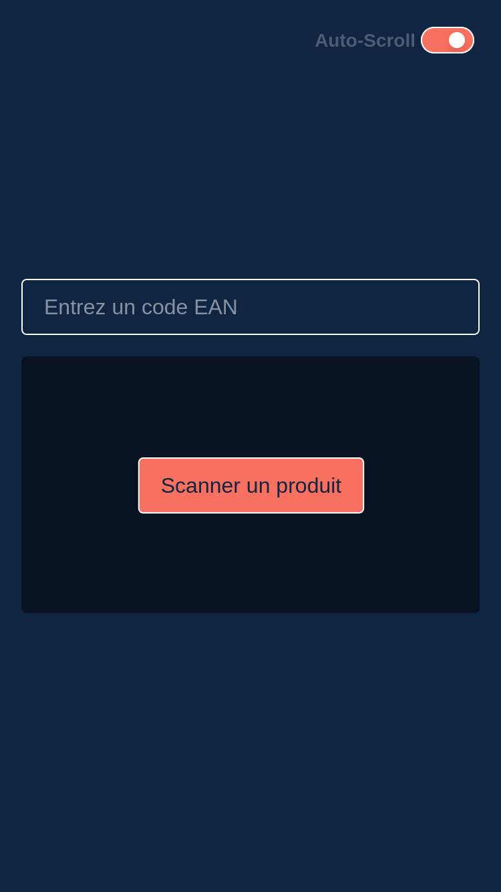
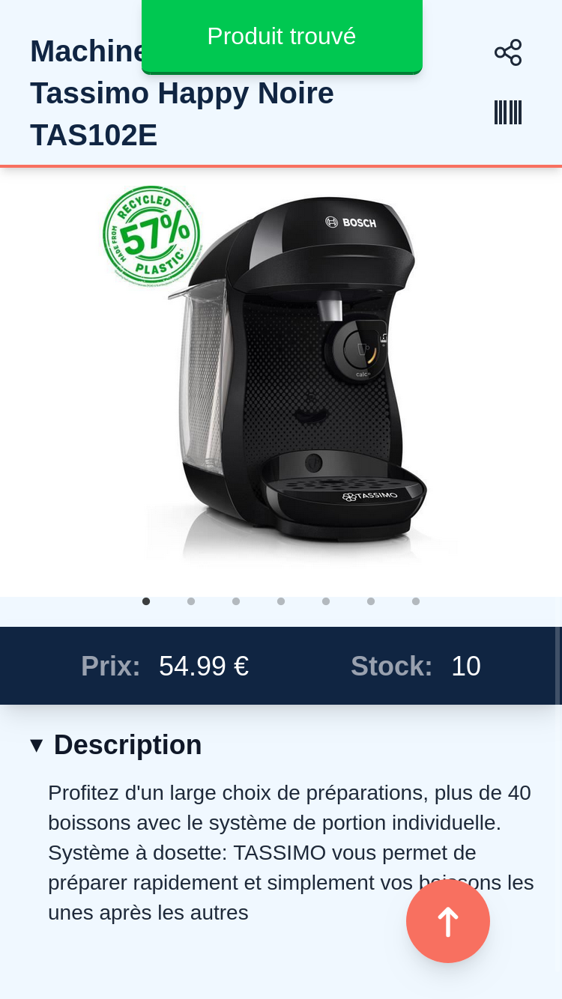

# E.Scan

Application web à destination des employés E.Leclerc pour consulter rapidement les stocks produits.

<p align="center">
    
</p>

## Description

E.Scan est une application web conçue pour les employés des magasins E.Leclerc, leur permettant de vérifier rapidement la disponibilité des produits en scannant leur code-barres (EAN). L'application interroge les endpoints publics du site e.leclerc (offres magasin et fiche produit) pour afficher le prix et le stock en temps réel du magasin configuré.

## Fonctionnalités
- Recherche de produits par EAN code
- Affichage des stocks en temps réel
- Partage de liens des produits

## Stack technique
- **Application** : Next.js (App Router, route handler `/api/search`), React, TailwindCSS
- **Scan** : [quagga2](https://github.com/ericblade/quagga2)
- **Hébergement** : VPS personnel

## Structure
- `src/app/api/search/route.ts` → API `GET /api/search?ean={13 chiffres}`
- `src/lib/leclerc.ts` → récupération des données E.Leclerc (cache 1 min)
- `src/components/` → interface (scanner, fiche produit, notifications)

## Lancer le projet
```bash
cp .env.example .env         # code magasin, 0772 par défaut
npm install
npm run dev                  # développement
npm run build && npm start   # production (sortie standalone)
```

## Données & RGPD
- Aucune donnée personnelle stockée
- Conforme au RGPD

## Captures d’écran
<p align="center">
    
    
</p>

## Mentions légales
Ce projet est pensé et développé par **Luca Pourceau**.  
© 2025-2026 Luca Pourceau — Tous droits réservés.
